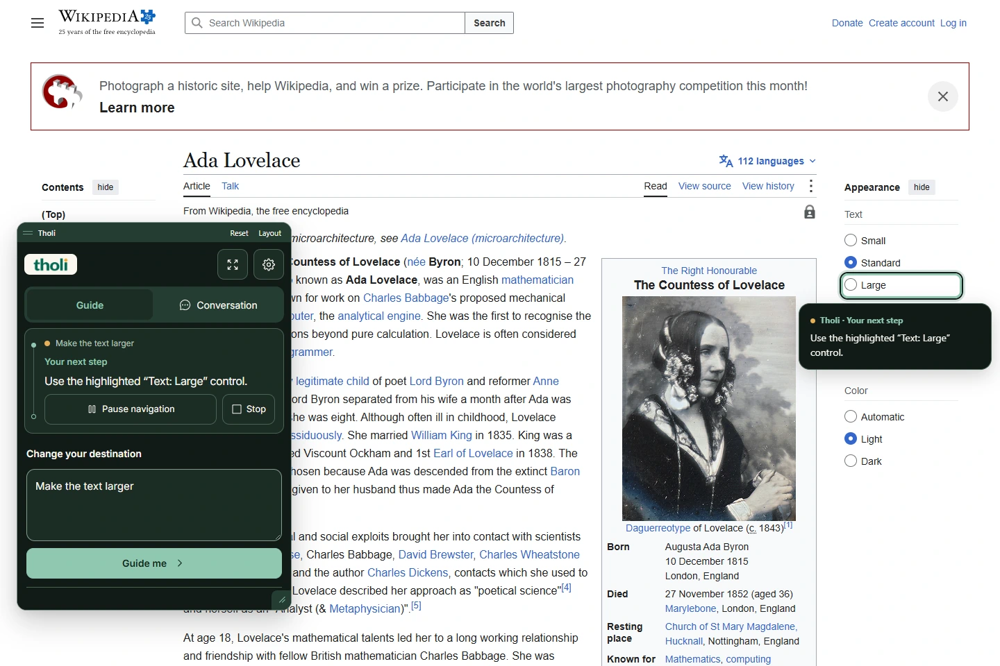
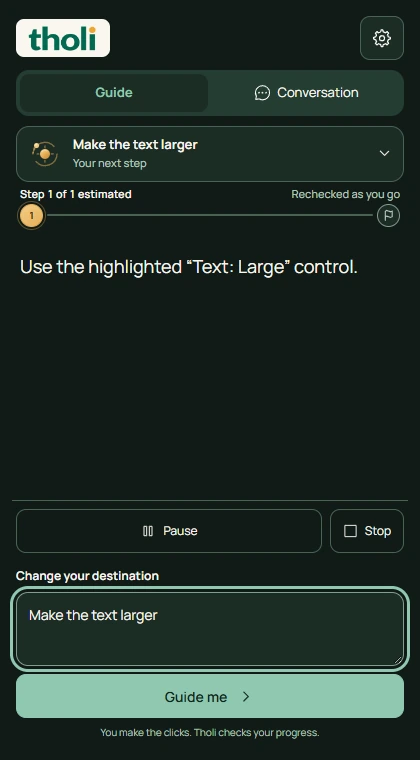
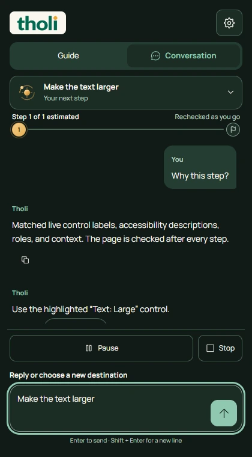

<p align="center">
  
</p>

<h1 align="center">Find your way forward.</h1>

<p align="center">Tell Tholi where you want to go. Follow a clear next step, right on the website.<br />You make the clicks. Tholi keeps the destination in view and checks the result.</p>

<p align="center">
  <a href="#try-tholi">Try Tholi</a> ·
  <a href="docs/README.md">Documentation</a> ·
  <a href="CONTRIBUTING.md">Contribute</a> ·
  <a href="docs/privacy.md">Privacy</a>
</p>

<p align="center"><strong>Desktop Chrome · English · Local processing · No account required</strong></p>



_Actual extension capture on public [Wikipedia](https://en.wikipedia.org/wiki/Ada_Lovelace), October 15, 2026. [Capture details and provenance](docs/product-screenshots.md). This example does not establish reliability on every website._

## A guide that stays with you

- **One destination, continuous guidance.** Keep your request through supported page changes, menus, login and two-factor verification.
- **Your interface, your choice.** Use the sidebar or a movable, resizable widget. Guide keeps the next action prominent; Conversation keeps the request and its context together.
- **You stay in control.** Tholi highlights freshly observed controls and can scroll them into view. You click, type, authenticate and submit. Arrival requires outcome evidence.
- **Local by default.** The packaged English language model and Tesseract OCR run on your CPU. No cloud model or backend is required.

<p align="center">
  
  
</p>

## Try Tholi

Use **Node 24.19.x** and npm. From the repository root:

```sh
npm ci
npm run build:extension
```

The build fetches and verifies pinned MiniLM and English Tesseract assets. These are bundled into the extension; installed inference needs no runtime model download.

1. Open `chrome://extensions` and turn on **Developer mode**.
2. Choose **Load unpacked** and select `dist/extension`.
3. Open a website, click the **Tholi** toolbar icon and allow website access if Chrome asks.
4. Enter a destination, such as **Make the text larger** on Wikipedia, then select **Guide me**.

After rebuilding, reload Tholi in `chrome://extensions` and refresh the website tab. [Chrome setup and permission recovery](docs/chrome-handoff.md) covers the details.

### Explore the local website

```sh
npm run dev:web
```

Open **http://127.0.0.1:5174** for the real extension recording, interactive practice, searchable docs, installation help and downloads. Sign-up and sign-in are explicitly mocked. Dark is the default; optional preference cookies can remember Light/Dark. Production analytics is disabled.

**Source version: 0.10.1. Packaged preview: 0.10.0.** The website reads download version and checksum from the eligible archive, independently of the source version. Downloads and extension use need no account. See [website setup and behavior](docs/website-redesign.md).

## Preview boundaries

Tholi is a working preview. Complex dashboards, unseen screens, inaccessible icon or canvas controls, closed shadow roots and native dialogs can still interrupt a route. An unclear route remains incomplete. OCR suggestions never establish completion. Native Chrome permission/accessibility checks and signed-in Amazon, Cloudflare and GitHub verification remain [pending](docs/chrome-handoff.md).

The default local pipeline combines Compromise, lexical retrieval and MiniLM. Optional backend and Chrome-model integrations are separate, opt-in features. **PaddleOCR remains experimental and is excluded from normal builds.** Its [evaluation and fallback status](docs/maintenance.md) must not be confused with default-engine support.

## Build and contribute

| Work                                | Command                                   | Output                         |
| ----------------------------------- | ----------------------------------------- | ------------------------------ |
| Extension                           | `npm run build:extension`                 | `dist/extension`               |
| Product website                     | `npm run dev:web` / `npm run build:web`   | Port 5174 / `dist/web`         |
| Controlled Northstar test workspace | `npm run dev:demo`                        | Port 5173                      |
| Optional local API                  | `npm run build:api` / `npm run start:api` | [API setup](docs/api-setup.md) |
| Types, unit tests and builds        | `npm run check`                           | Local validation               |

Install test Chromium once with `npx playwright install chromium`. The [contribution guide](CONTRIBUTING.md) lists focused checks, frozen corpora and exact-byte release gates. Packaging never substitutes historical test reports for the current build.

The extension worker owns journeys and verification; `packages/ui` owns shared presentation; the website practice uses an isolated, controlled adapter. Start with [frontend ownership](docs/frontend-architecture.md), [navigation architecture](docs/live-navigation.md), [NLP](docs/nlp-architecture.md), and [the documentation index](docs/README.md).

Reusable site knowledge stays local. Private values and task context remain session-only; screenshots and field values are not stored as route knowledge. [Privacy](docs/privacy.md) and [security](docs/security.md) describe the optional backend and deletion controls.

<p>
  
</p>

Tholi is operated by **[ILUNỌNSEN LLC](https://ilunonsen.com)**, Ohio, United States. [Contact](mailto:info@ilunonsen.com).

[MIT license](LICENSE) · [Third-party notices](THIRD_PARTY_NOTICES.md) · [Naming and compatibility](docs/naming.md)
