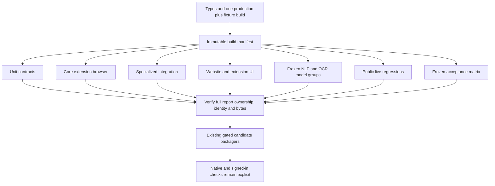

# Workflows and validation

Tholi separates productive development feedback, complete automated certification, and native or signed-in verification. A passing focused test, a convincing product recording, and a candidate archive describe different evidence. The central release invariant is one complete coordinated full run against the exact immutable application and inference bytes being packaged.

This map was derived from the current repository sources; it does not claim that new tests, native checks, certification, packaging or deployment were performed while creating the knowledge graph.

The graph-generation environment currently has Node 24.0.2 and no installed node_modules, which does not meet the project's Node 24.19.x setup. Product suites were not run for these graph-only documentation artifacts. Knowledge-graph JSON, source/evidence paths, identifiers and internal edge references are verified independently.

## Start with the current evidence

The latest [repository cleanup record](../../docs/releases/v0.10.1/repository-cleanup.md) is dated October 17, 2026. It explicitly leaves full certification incomplete. It records 285 passing unit contracts, passing deterministic/model groups, 47 passing core browser cases in a full attempt, 27 passing full UI cases, but public regressions with eight passes and six failures. The final PR attempt stopped after browser deadlines under severe memory pressure, and acceptance was incomplete. Earlier successful groups cannot make the final attempt pass. A final acceptance-harness correction passed types but still needs a clean browser rerun.

Observed memory pressure is evidence about the environment, not a proven explanation for every failure. The record separately retains geometry deadlines, picker readiness failures, a planning timeout, and an unhandled JSON parse error of unresolved origin. Hosted warm-cache runtime remains unmeasured; local timings do not verify the ten-minute hosted PR target.

The [website record](../../docs/releases/v0.10.1/website.md) describes an earlier 29/29 UI run and 96 route/width/theme combinations against its own extension and website hashes. Later playback and theme changes had focused checks. The [UI audit](../../docs/releases/v0.10.1/ui-audit.md) contains several dated builds and changing UI case counts. These are historical evidence for their corresponding bytes, not a current certification summary.

Source is 0.10.1, while the API component and eligible download remain 0.10.0. Component versions are allowed to differ. Source changes, branding changes, or successful website checks do not replace the immutable download. See [naming](../../docs/development/naming.md), [root metadata](../../package.json), [extension manifest](../../apps/extension/manifest.json), and [API metadata](../../apps/api/package.json).

## Establish a development environment

Use Windows and Node 24.19.x; the shared CI setup pins 24.19.0. From the root, install dependencies with `npm ci` and Chromium with `npx playwright install chromium`. The [setup action](../../.github/actions/setup/action.yml) restores npm cache and, when requested, pinned model/OCR directories keyed by operating system plus model-lock/OCR-lock hashes. Cached files still undergo hash verification.

The root `build` script builds demo, extension, website, API and test fixtures in that order. The extension build downloads or validates pinned local NLP/OCR inputs before bundling. The default build removes stale generated chunks and inactive experimental Paddle assets. Preserve generated entrypoint filenames: HTML and the extension manifest refer to them as public build contracts.

To use the extension, run `npm run build:extension`, enable Developer mode at `chrome://extensions`, and load `dist/extension` unpacked. After every rebuild, reload Tholi and refresh already-open website tabs so old injected code is replaced. The [Chrome setup guide](../../docs/guides/getting-started.md) specifies manual checks rather than claiming that installation fixtures exercise native Chrome UI.

To work on the website, run `npm run dev:web`; its local port is 5174 and `build:web` writes `dist/web`. The dev/build entry synchronizes the eligible archive into the generated website download mirror. No real account or backend is required. The demo fixture serves on 5173. During UI testing, `THOLI_UI_PORT=5188` can reserve a separate website preview without taking over an existing local preview.

## Find the existing validation owner

[Testing and CI](../../docs/development/testing/README.md) is the current command reference. [Coverage ownership](../../docs/releases/v0.10.1/coverage-ledger.md) explains moved and merged behavior; it is not a quota or a list of assertions that may be removed.

| Intent | Existing command or owner | Evidence limits |
| --- | --- | --- |
| Pure and explicitly DOM-dependent contracts | `npm test`, or `npm test -- lifecycle.test.ts` | Focused development evidence |
| Types, unit tests, production build | `npm run check` | Does not certify all browser/model/live behavior |
| Deterministic PR gate | `npm run test:ci` | Cannot authorize packaging |
| Complete automated certification | `npm run test:full` | Requires all groups, complete selection, one run and matching bytes |
| Existing focused browser ownership | `npx playwright test --project core-desktop`, or named aliases | Requires prepared production/fixture build; focused pass cannot certify a release |
| Native permissions, real screen-reader output, native zoom, signed-in workflows | Manual checklist in getting-started | Pending until actually performed and recorded |

[The coordinator](../../scripts/test.mjs) owns task selection, tier, shared run identity, immutable preparation, group execution, timing records, and final full verification. Root runner files are thin editor entrypoints; actual [Playwright](../../config/testing/playwright.ts) and [Vitest](../../config/testing/vitest.ts) definitions live under `config/testing`.

Vitest has `unit`, `nlp`, `multi-app`, and `vision` projects. Pure tests default to Node; DOM-specific files select jsdom explicitly. Browser behavior belongs under `tests/browser`; shared fixture/provenance/report utilities live in `tests/support`. Permanent tests should represent a distinct contract or regression and extend the existing owner.

The cleanup moved 13 authored static golden states from repeated browser viewport executions to [navigation unit coverage](../../tests/unit/navigation/core.test.ts). Their exact IDs and status/state/target assertions remain. Dynamic picker cases merged into lifecycle tests. Public language and reported-page cases moved to live coverage, while deterministic missing/clipped fragment behavior remains in multi-app coverage. Responsive layout checks remain separate from viewport-independent feature behavior.

## Follow the build and evidence graph

[The build manifest](../../scripts/build-manifest.mjs) recursively snapshots `dist/demo`, `dist/test-fixtures`, `dist/extension`, `dist/web`, `apps/api/dist`, `assets/models`, and `assets/ocr`. The prepared-build option `THOLI_BUILD_PREPARED=1` skips duplicate build preparation only after verifying this manifest. It is not permission to reuse mutable output.

Browser groups serve production previews of those prepared artifacts. Core/integration need the demo preview; UI needs demo and website; live needs neither; acceptance needs the demo for its local fixtures. Coordinated runs use strict ports and reject unrelated existing servers. Browser fixtures wait for worker state and panel-ready controls, rather than assuming a running worker means the presentation is ready.

Fresh disposable Chromium profiles isolate test state. Fixture-only permission copies are built once per worker. Automatic-download prompts can be explicitly pregranted. Only the two export fixtures use disk-backed blob transport after an observed host-memory quota failure; product exports and performance profiles keep normal browser behavior. These fixtures retain actual browser download completion and exact JSON/privacy assertions without claiming native Chrome grant verification.

[Evidence completeness](../../tests/support/evidence.ts) requires nonempty unique expected IDs, matching case count, unique actual IDs, membership in expected cases, and passed status for every case. Common [build provenance](../../tests/support/build-provenance.ts) records recursive extension hashes, extension version and validation identity. Specialized acceptance metrics remain separately owned.

## Understand PR and full tiers

[The PR workflow](../../.github/workflows/ci.yml) runs for pull requests, pushes to main and manual dispatch. It cancels superseded runs, uses read-only repository contents permissions, and assigns identity `run_id-run_attempt`. A build job uploads immutable application and inference artifacts. Four matrix groups, with up to three concurrent jobs, download and verify them: core, UI, integration and unit. The final `validate` job uses `always()` and fails unless both build and tests succeeded, including cancellation cases.

PR browser contexts enforce fixture-only public-network policy through [browser-test.ts](../../tests/support/browser-test.ts). Fulfilled fixtures can model public origins without live access; unexpected public HTTP requests abort and fail the case. The same local-group policy applies during full coordination, while live/acceptance groups intentionally permit public sites.

Full tier adds real model/OCR workloads, public-site journeys, complete frozen acceptance, 50,000-node/busy-page performance cases, all-width/all-theme website reflow and scroll profiling. PR deferral does not remove these contracts. Focused UI/multi-app/reliability aliases retain full ownership, so their scope should not be inferred from PR exclusions.

[The full workflow](../../.github/workflows/full-validation.yml) runs nightly at 06:00 UTC, manually, and for `v*` tags. It builds once and schedules seven groups: acceptance, live, core, models, UI, integration and unit. Each group uploads only owned report paths. Certification downloads the immutable build plus evidence matching the current attempt, verifies the manifest and runs `verify-full.mjs`. A failed full attempt requires rerunning all jobs; combining successful old-attempt evidence with new evidence is rejected.

## Preserve acceptance inputs and independent outcomes

[The frozen matrix](../../tests/browser/acceptance/matrix.json) declares five Wikipedia articles, six control goals and two viewport sizes: 60 supported live attempts, plus 30 generic browser scenarios. Thirteen authored states still belong to the unchanged declaration but execute once in unit coverage, not again at two browser widths.

[The benchmark contract](../../docs/development/testing/acceptance.md) distinguishes each requested result. Show search requires focus, while searching for a topic requires the requested result. Showing languages means opening a picker and awaiting a choice; choosing a language and reaching its destination are different evidence. Actual input state, focus, geometry and website language UI form independent browser oracles. Test-only expected selectors/roles do not flow into production planning.

Target precision must be at least 98%, verification precision at least 95%, and supported completion at least 90%. Refusals/timeouts remain in the supported denominator; zero-denominator ratios fail. False success, automation, known sentinel leakage, missing attachments, infrastructure errors, unexpected IDs, duplicate cases and any known failed case block the gate.

[The accuracy reporter](../../tests/support/accuracy-reporter.ts) checks exact declared IDs and unchanged build identity, records matrix SHA-256, source revision/dirty state, extension/protocol versions, browser versions and case details. [Checkout integrity](../../tests/unit/tooling/checkout-integrity.test.ts) materializes a Windows-style Git checkout and verifies frozen corpus, caption, transcript and matrix bytes; `.gitattributes` protects LF-sensitive evidence.

Production waiting differs from a test deadline: ordinary waits become recoverable after two minutes and authentication has no task-expiry deadline. Frozen benchmark denominators and bounded assertion windows remain unchanged. Neither waiting nor search-budget exhaustion may convert an unresolved objective into success.

## Release eligibility and immutable archives

[Full verification](../../scripts/verify-full.mjs) first verifies the immutable manifest, then requires complete full evidence from the same run and extension digest. It verifies exact required browser project sets and recursively enumerated owner files, checks matching API bytes where reported, and checks website built assets, source files and HTML bootstrap where present.

[Identity rejection](../../scripts/evidence.mjs) rejects failed reports, PR tier, focused selection, missing or uncoordinated run IDs, mismatched extension hashes/digest and mixed run identities. A passing subset is useful development feedback but cannot satisfy this identity.

[The extension packager](../../scripts/package-extension.mjs) runs full verification before reading the evaluated build, enforces specialized NLP/multi-app/vision/reliability gates, validates acceptance/version and full UI evidence, refuses existing legacy/current archive names, archives without rebuilding, and reads every ZIP member back to compare its hash against evaluated bytes. Adjacent checksum/report records retain native handoff and signed-in limitations. [The API packager](../../scripts/package-api.mjs) similarly verifies full evidence and matching API bytes, includes pinned model/OCR assets, and refuses existing version archives.

Workflow packaging runs only for version tags or explicit manual package input after certification. This knowledge-map task does not authorize invoking those steps. Publishing, deployment and replacing an existing archive require explicit authorization.

[Download synchronization](../../scripts/sync-downloads.mjs) accepts current and legacy archive names, validates checksums, selects newest eligible version and copies it into the generated website mirror. It may remove older mirror archives; original release archives remain unchanged. A version label or filename change cannot make old reports certify new bytes.

## Separate local product demonstrations from extension authority

Website [practice](../../apps/web/src/features/demo/usePracticeAdapter.ts) uses actual shared guidance components inside an isolated shadow root, but its adapter owns only controlled sample state. It supports account settings and changing the saved sample language to Spanish. The adapter checks those actual sample states before showing arrival; this demonstrates shared presentation and interaction, not general website-routing reliability.

Website [accounts](../../apps/web/src/features/account/session.tsx) store mock name/email/onboarded state in session storage. [The form](../../apps/web/src/features/account/AuthPage.tsx) keeps passwords component-local, clears them after success and sends no authentication request. Extension use and downloads need no account.

[Website preferences](../../apps/web/src/features/preferences/cookies.ts) are independent of installed-extension preferences. Explicit necessary `tholi_consent` lasts at most 180 days; optional `tholi_theme` cannot outlive consent and is removed on withdrawal. Dark-first [HTML startup](../../apps/web/index.html) applies Light before paint only with current validated preference consent and never queries OS theme or writes startup preference storage. Without optional storage, appearance works in memory.

[Analytics](../../apps/web/src/features/preferences/analytics.ts) has no configured production provider. Its inactive boundary accepts only allowlisted page/download/practice events and requires matching provider/disclosure consent. Withdrawal aborts or discards optional work; arbitrary destinations, conversations, account data, documentation queries and extension observations are excluded.

[Documentation registry](../../apps/web/src/features/docs/registry.ts) allowlists eleven articles, keeps search local and maps moved legacy Markdown paths. Safe GFM rendering uses no raw HTML; images become repository source links rather than remote fetches. Legal pages remain launch-review drafts, with hosting, public domain, provider selection and final legal review pending.

## Treat captures as scoped evidence

`npm run capture:web` captures actual extension screenshots on public Wikipedia. [The tool](../../scripts/capture-product-screenshots.mjs) requires a fresh live plan for Large text, actual engine completion and UI arrival before recording success. Disposable profiles avoid personal browser data. WebP provenance records request, page, version, dimensions, date and hashes; PNG sources remain ignored.

`npm run capture:video` uses [the recording tool](../../scripts/capture-product-video.mjs) with a frozen extension. It attempts public GitHub Pull requests, then explicitly labels the Wikipedia fallback when GitHub cannot be verified. Worker completion and unchanged extension bytes are mandatory. Local light/dark WebM, posters, captions, transcript and provenance retain their source relationship. Disposable host pregrants do not certify native activation.

Presentation remains subordinate to actual outcomes. A click, focus, picker opening, waypoint orbit, terminal animation or screenshot cannot establish unrelated creation, publication, deployment or cancellation. Current guidance requires fresh task-specific result evidence and rejects wrong-subject statuses.

The severe mutation workload remains a performance limitation. Cleanup records 1150.1 ms frame-interval p95 for its 50,000-node run; earlier UI and website records contain different values for their workloads and builds. Stable highlight identity and passing functional motion checks are not a smooth-frame guarantee. Native Chrome, screen readers, native zoom and real signed-in workflows remain pending until separately performed.

