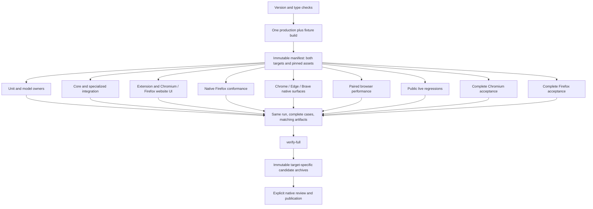

# Workflows and validation

Tholi now builds one shared local engine for Chromium and Firefox and prepares a unified **0.11.0 release, still unreleased**. Browser support, evidence ownership and versioning have advanced substantially since the previous map. Preparation, a passing PR cohort and complete final-byte release certification remain distinct.

This tour describes reviewed repository sources. The original isolated rescan did not execute product suites. For checks in the merged checkout, use the installed Node 24.19.0 from the Scoop Node LTS directory; the default PATH also contains an older Node installation. Mapping artifacts can be checked independently, but they cannot certify the extension. Follow the testing commands below for current product validation.

## What changed since the previous map

| Earlier map | Current source | Consequence |
| --- | --- | --- |
| Chromium setup and one extension artifact | Chromium 140+ plus Firefox 153+ targets | Both target digests and independent runtime evidence matter |
| Root/extension 0.10.1 and API 0.10.0 | Root, API, extension and bundled workspaces share 0.11.0 | One version procedure checks manifests, pins, lockfile and notes |
| Four PR test groups | Unit, core, integration, Firefox and UI | Actual Firefox extension behavior enters deterministic feedback |
| Seven full groups | Eleven full groups, including split acceptance, brands and paired performance | A passing subset cannot substitute for the complete evidence graph |
| Cleanup record as newest evidence | Browser implementation, navigation reliability, versioning and October 19 performance records | Historical passes must remain attached to their dated bytes |
| Native browser behavior mostly pending | Recorded automated Chrome/Edge/Brave/Firefox surface checks | Manual permission, accessibility and signed-in review still require their own evidence |

The [release notes](../../docs/releases/v0.11.0/README.md) and [validation record](../../docs/releases/v0.11.0/validation.md) explicitly prevent pre-version 0.10.1 evidence from certifying 0.11.0. The [performance follow-up](../../docs/releases/v0.11.0/performance.md) subsequently supersedes the October 18 build digests. Its complete PR cohort and final cache-adjustment cohort are separate evidence sets.

## Establish the current environment

Use Windows, Node 24.19.x, `npm ci`, and `npx playwright install chromium firefox`. [Shared CI setup](../../.github/actions/setup/action.yml) pins Node 24.19.0 and caches npm plus optional pinned model/OCR assets. Caches never replace asset hash validation.

`npm run build:extension` builds both targets. To focus one, pass `-- --target=chromium` or `-- --target=firefox`. [Target generation](../../config/extension-targets.mjs) derives both manifests from the common source; Firefox replaces Chromium side-panel/offscreen assumptions with a nonpersistent background and native sidebar. [The builder](../../scripts/build-extension.mjs) preserves generated entrypoint names, pinned model/OCR inputs and one local engine.

Load `dist/extension` unpacked through Chrome, Edge or Brave's extension manager. Firefox uses `about:debugging`, **This Firefox**, **Load Temporary Add-on**, and `dist/extension-firefox/manifest.json`. Firefox requires 153+, has add-on ID `tholi@ilunonsen.com`, and this unsigned developer preview disappears when Firefox restarts. Reload after rebuilding and refresh website tabs so injected content is current. Other Chromium browsers are capability-compatible rather than explicitly branded-verified; Safari/WebKit are outside this target set. See [browser setup](../../docs/guides/getting-started.md) and [browser metadata](../../config/browsers.json).

`npm run dev:web` runs the website on port 5174; `build:web` writes `dist/web`. The demo uses 5173. Coordinated UI checks can use `THOLI_UI_PORT=5188`, and refuse unrelated servers on reserved ports. Downloads are target-specific and derived from eligible archives; an unavailable Firefox archive leads to source setup rather than a Chromium ZIP.

## Extend the existing validation owner

[Testing and CI](../../docs/development/testing/README.md), [coverage ownership](../../docs/releases/v0.10.1/coverage-ledger.md) and [the coordinator](../../scripts/test.mjs) own commands and responsibilities. Pure tests default to Node, with jsdom only where required. [Vitest projects](../../config/testing/vitest.ts) are unit, NLP, multi-app and vision; [Playwright projects](../../config/testing/playwright.ts) identify browser ownership.

| Need | Command or owner | Evidence limit |
| --- | --- | --- |
| Unit/DOM contracts | `npm test` or existing focused owner | Development feedback |
| Types, fast tests, build | `npm run check` | Not complete browser/model certification |
| Deterministic PR gate | `npm run test:ci` | Five groups, one build; cannot authorize packaging |
| Complete certification | `npm run test:full` | Eleven groups, one run, exact final artifacts |
| Actual Firefox extension | `node scripts/test.mjs firefox` | Selenium/geckodriver, not Playwright's browser build |
| Firefox website | `ui-website-firefox` | Website behavior, not extension privileges |
| One complete acceptance target | `node scripts/test.mjs full --group acceptance-chromium` or `acceptance-firefox` | Requires the existing coordinated prepared-build identity to join its evidence |
| Native permissions, speech, signed-in accounts | Recorded user-assisted checklist | Pending until actually performed |

Native Firefox resolution checks Windows App Paths, including Store registration; `THOLI_FIREFOX_BINARY` selects an isolated official build. Chrome/Edge use installed browsers; Brave uses the official pinned portable tool or `THOLI_BRAVE_BINARY`. [Browser-tool configuration](../../config/testing/browser-tools.json) pins versions/checksums. Disposable profiles protect personal state.

The thirteen authored golden engine states still execute once in [unit navigation coverage](../../tests/unit/navigation/core.test.ts). Both browser targets reuse frozen goal contracts and independent outcome oracles rather than duplicating a navigation engine. [Firefox acceptance](../../tests/browser/acceptance-firefox/matrix.spec.ts) supplies native interactions around the [shared acceptance runner](../../tests/support/acceptance-runner.ts).

## Follow the release evidence graph

[The immutable build manifest](../../scripts/build-manifest.mjs) hashes demo, test fixtures, both extension builds, website, API and model/OCR assets. `THOLI_BUILD_PREPARED=1` is valid only for verified immutable artifacts. Production packages exclude test fixtures.

[Full verification](../../scripts/verify-full.mjs) requires matching target digests, complete suite/project ownership and one coordinated identity. It verifies Chrome/Edge/Brave versions and native surfaces, Firefox event-page/settings/native-surface cases, both complete acceptance reports, website source/bootstrap/build and API bytes. Missing, duplicated, skipped or failed collected cases fail certification. The [PR workflow](../../.github/workflows/ci.yml) rejects failed or canceled dependencies; [full CI](../../.github/workflows/full-validation.yml) runs nightly at 06:00 UTC, manually or on tags and merges only current-attempt owned evidence. After a failed hosted full attempt, rerun all jobs rather than mixing attempts.

[Version preparation](../../scripts/version.mjs) requires an increasing browser-compatible X.Y.Z and matching release notes before metadata writes. It synchronizes internal pins and lock metadata without upgrading external dependencies. `check:version` rejects drift and tags other than `vVERSION`. Storage/API protocols, model revisions, consent versions and package identities remain separate compatibility contracts. See [releasing](../../docs/development/releasing.md) and [naming](../../docs/development/naming.md).

Packagers reverify full evidence and package without rebuilding. Candidates are `tholi-VERSION.zip`, `tholi-firefox-VERSION.zip` and `tholi-api-VERSION.tgz`; originals remain immutable. Conditional CI packaging is not signing, browser-store submission, deployment or publication. Changing a version changes bytes and requires new evidence.

## Assess the actual evidence

The October 17 [browser implementation record](../../docs/releases/v0.10.1/browser-support.md) records passing native Chrome/Edge/Brave and Firefox surfaces on dated builds. Firefox completed twelve acceptance cases containing ninety samples with zero false arrivals, automated actions or secret leakage. Chromium had no complete passing final acceptance report, so aggregate certification correctly remained closed. Those results cannot certify later 0.11.0 bytes.

That record isolates seven IndexedDB transaction aborts at roughly five seconds as the mechanism behind a Chromium persistence assertion failure. The underlying cause remains unresolved; severe memory pressure is correlation, not proof. Later records improve evidence but do not retroactively turn interrupted attempts into passes. The [earlier cleanup record](../../docs/releases/v0.10.1/repository-cleanup.md) preserves its own public-site failures and interrupted acceptance.

The latest [October 19 performance record](../../docs/releases/v0.11.0/performance.md) reports:

- A complete PR cohort of **400 passes**: 299 unit, 47 core, 20 integration, two native Firefox and 32 UI cases.
- A later final cache cohort with types/builds, **299 unit + 32 model/OCR + one paired experiment**, separate from that PR cohort.
- Local Chrome/Firefox warm planning p95 **129/166 ms**, OCR **660/649 ms**, Pause **13/15 ms**, Stop **6/20 ms** on its stated host.
- Long frames remain under the 50,000-node mutation scene: **250/233 ms p95** with Tholi running. Ordered stopped comparisons do not establish causal improvement.

The final cache change affects inference bytes and source maps. No complete final-byte `test:full` certificate follows from combining those cohorts. Whole-browser memory snapshots are neither extension-only usage nor peaks; worker release does not imply a fixed Task Manager reduction. Current [validation](../../docs/releases/v0.11.0/validation.md) still marks release gates pending.

## Trust boundaries and remaining risk

Firefox's embedded extension frame cannot call privileged native sidebar/tab APIs. Dock retains the widget and requests a toolbar action; only successful native opening removes it. Gecko BiDi cannot intercept privileged extension networking, so website interception and packaged CSP/settings/transport checks are separate evidence owners. These explicit limitations are stronger than assuming Chromium behavior transfers to Firefox.

The optional [single-owner API](../../docs/guides/backend.md) remains local/self-hostable, with exact installation-origin allowlists and private tokens. Firefox's internal `moz-extension` UUID differs from its add-on ID; each origin must be explicitly authorized. Accounts and synchronization remain unimplemented. No cloud model, SaaS tenancy or commercial service is established by the current browser/release work.

[Journey verification](../../docs/guides/journeys.md) still requires fresh live outcomes. Assistance is opt-in and bounded; menus and view options do not permit credentials, forms or consequential final actions. A click, docking event, animation, authored fixture or practice completion cannot establish real signed-in success. [Diagnostics](../../docs/guides/troubleshooting.md) remain bounded and sanitized; [appearance](../../docs/guides/appearance.md) reads styling rather than screenshots or fields.

Real signed-in Amazon/Cloudflare/GitHub, native permission dialogs, actual screen-reader speech, manual installation/accessibility review, hosted timings and weaker-CPU measurements remain pending unless separately recorded. Historical [website](../../docs/releases/v0.10.1/website.md), [UI](../../docs/releases/v0.10.1/ui-audit.md) and [media provenance](../../docs/development/media-capture.md) describe their own bytes and narrower claims. Existing 0.10.1 footage remains truthful historical product evidence, not 0.11.0 certification.
