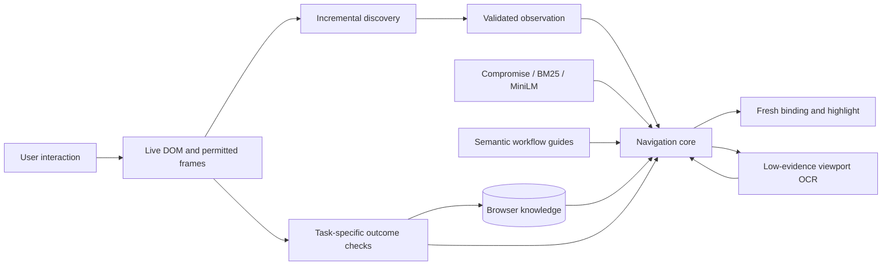

# Live navigation architecture

## Discovery

`packages/page-discovery` maintains an incremental control index in cooperative work slices. Discovery covers semantic controls, named custom interactive candidates, open shadow roots and authorized frames. It prioritizes active dialogs/menus, global navigation, task regions, headings and footer controls. Up to 5,000 controls remain in the session; planning uses bounded projections of at most 600. Coverage reports omissions. An omitted or unmounted control is not evidence that the website has no route.

Accessible-name and role algorithms are adapted from pinned Playwright browser-side code, with source hashes and attribution. Input values and editable contents are excluded. Heading/region ancestry, form metadata and reveal relationships provide context. Geometry, visibility, occlusion, availability and risk are checked independently from semantic embedding identity.

A document control ID binds to an actual element. Changed meaning or recycled nodes invalidate signatures and bindings. Only a fresh eligible target can be highlighted or scrolled into view; user input cancels pending scrolling. Each frame owns its discovery and overlay, with explicit host access.

## Interpretation and planning

`packages/navigation-core` coordinates Compromise interpretation, BM25/MiniLM retrieval, grounded goal planning, task queues and contextual workflows. Desired values, exclusions and compatible references survive replanning. Semantic scores rank candidates; they cannot override scope, consequential boundaries or verification. Ambiguous meanings produce grounded choices.

Journeys preserve an objective independently of current controls. Bounded graph search uses verified transitions and documented milestones. Future steps are predictions requiring live binding. Return actions use observed dismissal controls, relevant session predecessors or associated tabs; forward actions are never presumed reversible. Missing evidence enters bounded recovery rather than inventing a route.

Ordinary authentication phrases share punctuation and synonym normalization across interpretation and retrieval. Main-content or foreground-menu evidence can disambiguate repeated navigation controls. Duplicate links to the same destination form one choice; distinct equally grounded destinations still require a user decision. Selected navigation plus its live route, or an open menu and its next grounded control, can reconcile intermediate workflow stages. Neither reconciliation nor a click establishes final arrival. A workflow waits for independent effects before repeating an action; a timed-out attempt is excluded in the same document state.

A changed scan retains the destination and replans from a fresh observation. Pending indexing uses bounded recovery instead of a transient error banner. Native document and session mismatches still reject stale commands; observation revision recovery cannot grant authority to another document.

Optional browser-model interpretation is experimental. It returns current control IDs and structured intent, without selectors, actions or completion authority. The default NLP path works offline without it. The optional HTTP adapter uses the same core; transport and browser lifecycle remain outside it.

## Guidance, OCR and outcomes

The extension owns binding and verification. Guide mode leaves interaction with the user. The optional **Assisted navigation** setting can open a fresh, eligible ordinary menu/disclosure and select an explicitly requested view option. Its shared policy refuses links, forms, credentials, final actions, unknown effects and cross-frame targets. The privileged worker rechecks opt-in, active tab, native document, request, scan and expanded surface; content rechecks the live binding, visibility and risk. Minimized, hidden, paused or stale guidance cannot act. Attempts are bounded; sites requiring trusted activation still need manual interaction. No synthetic click proves an outcome.

Tholi observes normal interactions automatically. Authentication retains context without expiry; ordinary waiting and recovery retain an incomplete task. Review clicks start verification and never prove success.

Tesseract OCR runs in a separate local worker only when discovery evidence is insufficient. Editable fields and all iframe pixels are masked across the full image before processing. A visible, unoccluded open menu/dialog can receive one bounded region pass; low-confidence results fall back to the masked viewport. Coordinates remain in the original capture space and are ephemeral. Fresh DOM bindings take precedence. OCR-only suggestions require unambiguous text and retain unknown effects. The pinned model is unchanged. Paddle is available only in an explicit experimental build and has not passed startup/promotion gates.

Task-specific results, such as the requested selected value, destination, created item, deployment status or Prime membership state, establish completion. Wrong outcomes and unrelated toasts cannot advance the task queue.

## Storage and compatibility

IndexedDB v5 preserves site knowledge and parameterized saved routes. Incompatible derived indexes are rebuilt independently of original records. Session context holds private names, supplied values, unfinished journeys and the task-scoped navigation ledger. Screenshots, private OCR text and image coordinates are not persisted.

Verified transitions retain their observed counts and latency. A bounded, idempotent timeout signal can reduce confidence in an already observed ordinary route edge; it never creates a route or proves it impossible. Later verified success reduces that penalty. Feedback stores existing hashed state/signature keys, not destination text or captured content.

The optional Fastify/SQLite service mirrors explicitly connected reusable knowledge; the browser remains authoritative. v1 remains compatible, and v2 adds workflow/visual contracts and capability negotiation. An unavailable or older backend falls back locally. See [NLP](natural-language.md), [privacy](privacy.md), [API setup](../guides/backend.md) and [lifecycle](sessions.md).
