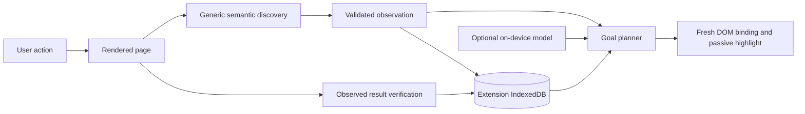

# Live navigation architecture

PageDiscovery extracts fields, buttons, links, toggles, choices, selects, summaries and headings using HTML/ARIA semantics. Labels come from associated labels, aria-label/labelledby, title/alt and safe control text. Accessibility descriptions follow aria-describedby, aria-description and title precedence; references to form values are excluded. Grouping uses landmarks, fieldsets and nearby headings. aria-haspopup identifies popup buttons, including checkbox-backed buttons and links that open menus. aria-controls/popover relationships and nearby containment identify menu reveal steps. References are resolved within the document or shadow root that owns them. No site IDs/classes or Wikipedia URL allowlists participate.

A document control ID binds only to one actual element. Stable signatures use role, action kind, label, description, popup type, context and destination identity; they omit IDs/classes and coordinates. Each semantic/element change updates the observation revision, so changed descriptions also invalidate pending guidance and stored controls. A pending plan must match that revision and document. The coach observes mutations, scroll, resize, focus, change and navigation through the shared BrowserAdapter observer.

Goals use English token/synonym matching, regular singular/plural equivalence, match thresholds and ambiguity checks. Decorative counts are excluded from label penalties, while requested qualifiers must have evidence in the label, description or context. Unreachable hidden duplicates cannot compete with usable controls, and indirect reveal routes receive a small cost. A hidden target requires one sufficiently clear visible reveal control. Match strength is a heuristic ranking score, not a calibrated probability of success; the panel displays qualitative strength. Already checked choices or arrived sections complete with observed evidence. If a goal exists only on a remembered page, breadth-first search uses active observed transitions to find a current first step, then replans from the next actual page. Inferred links are remembered separately and never advertised as verified historical routes.

Detached popups are associated through declared ownership/label relationships, or matching purpose plus focus or nearby geometry. An unrelated dialog is not evidence that a selected menu opened. Reveal inference respects declared ownership and stays within a single local widget; shared toolbar/header ancestors do not establish a route. A verified final menu-opening step enters awaiting-choice rather than claiming the requested preference changed. Asking again while that menu is observed open preserves the choice state instead of guiding the user to close it.

Repeated navigation links are interchangeable only when their complete destination matches, including query and fragment. The snapshot uses an ephemeral URL fingerprint for this comparison; persistent memory omits that field. Combined control signatures still invalidate when a destination changes. Equivalent entries in suggested/all choices do not create false ambiguity, while distinct destinations remain ambiguous.

Chrome's optional Prompt API runs in the side panel, not the service worker. Its system instruction treats observations as untrusted data, including accessibility descriptions and popup metadata. Structured output is bounded to real control IDs and confidence. Runtime validation rejects invented, duplicate, unsafe, hidden-first or disconnected steps. A model suggestion that conflicts with a substantially stronger, unambiguous live match falls back to the grounded plan. DOM verification supplies outcomes, independent of model text. Failed/unavailable inference falls back to semantic planning. Model accuracy still needs evaluation on supported hardware; the browser integration tests use semantic mode and validated proposals.

IndexedDBSiteMemory implements SiteMemoryStore. The stable version-1 database has a sites object store containing bounded page, template and transition records. Layout/language/path-family keys distinguish templates; structure revisions update records rather than altering database tables. Controls absent from a complete scan become inactive and invalidate affected transitions. Hidden controls remain discoverable; partial scans cannot prove removal. Counts and Forget/Clear actions are exposed in the panel. A future SQLite implementation can implement the same interface without replacing discovery or planning.

The navigator learns progressively from the user's visits and verified interactions. It does not background-spider the site or invent routes through unloaded pages. The current adapter operates in the top document and open shadow roots. Opaque frames/canvas controls and poorly labeled controls require additional adapters or user interpretation.

API references: [accessible names and descriptions](https://www.w3.org/TR/accname-1.2/), [menu button semantics](https://www.w3.org/WAI/ARIA/apg/patterns/menu-button/), [Chrome Prompt API](https://developer.chrome.com/docs/ai/prompt-api), [extension storage](https://developer.chrome.com/docs/extensions/develop/concepts/storage-and-cookies), [optional permissions](https://developer.chrome.com/docs/extensions/reference/api/permissions).
