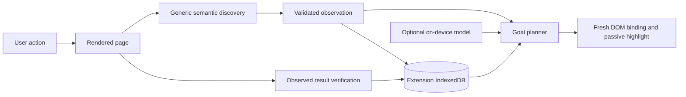

# Live navigation architecture

PageDiscovery extracts fields, buttons, links, toggles, choices, selects, summaries and headings using HTML/ARIA semantics. Labels come from associated labels, aria-label/labelledby, title/alt and safe control text. Accessibility descriptions follow aria-describedby, aria-description and title precedence; references to form values are excluded. Grouping uses landmarks, fieldsets and nearby headings. aria-haspopup identifies popup buttons, including checkbox-backed buttons and links that open menus. aria-controls/popover relationships and nearby containment identify menu reveal steps. References are resolved within the document or shadow root that owns them. No site IDs/classes or Wikipedia URL allowlists participate.

A document control ID binds only to one actual element. Stable signatures use role, action kind, label, description, popup type, context and destination identity; they omit IDs/classes and coordinates. Each semantic/element change updates the observation revision, so changed descriptions also invalidate pending guidance and stored controls. A pending plan must match that revision and document. The coach observes mutations, scroll, resize, focus, change and navigation through the shared BrowserAdapter observer.

Goals use English token/synonym matching, regular singular/plural equivalence, thresholds and ambiguity checks. Requested qualifiers need evidence in labels, descriptions or context. Hidden targets require clear opening relationships. Match strength is heuristic, displayed qualitatively. Checked choices and arrived sections complete with observed evidence. Persistent journeys retain destination values and verified progress across screens. Weighted Dijkstra routing uses active observed transitions and timing samples, rebinds the current first step and replans on arrival. Inferred links and predicted destinations never become verified history. See [task routing](task-routing.md).

Detached popups are associated through declared ownership/label relationships, or matching purpose plus focus or nearby geometry. An unrelated dialog is not evidence that a selected menu opened. Reveal inference respects declared ownership and stays within a single local widget; shared toolbar/header ancestors do not establish a route. A verified final menu-opening step enters awaiting-choice rather than claiming the requested preference changed. Asking again while that menu is observed open preserves the choice state instead of guiding the user to close it.

Repeated navigation links are interchangeable only when their complete destination matches, including query and fragment. The snapshot uses an ephemeral URL fingerprint for this comparison; persistent memory omits that field. Combined control signatures still invalidate when a destination changes. Equivalent entries in suggested/all choices do not create false ambiguity, while distinct destinations remain ambiguous.

Chrome's optional Prompt API runs in the side panel, not the service worker. The context and intent pipeline is described in [page-context.md](page-context.md). Observations are untrusted data; model output cannot supply selectors, effects or completion claims. Invalid, empty, unsafe or conflicting suggestions preserve an existing clear semantic route or action boundary. Model accuracy still needs evaluation on supported hardware; deterministic adapter tests establish the contract rather than language understanding quality.

IndexedDBSiteMemory implements SiteMemoryStore. Database version 2 preserves the sites store and adds bounded saved task routes in a tasks store. Site records retain latest pages, state snapshots, templates and transitions; old version-1 site records remain compatible. Layout/language/path-family keys distinguish templates. Complete scans inactivate absent controls and affected transitions; partial scans cannot prove removal. Hidden controls remain discoverable. Counts, saved routes and Forget/Clear actions appear in the panel. A future SQLite implementation can implement the storage interface.

The navigator learns progressively from the user's visits and verified interactions. It does not background-spider the site or invent routes through unloaded pages. The current adapter operates in the top document and open shadow roots. Opaque frames/canvas controls and poorly labeled controls require additional adapters or user interpretation.

Local heading ownership identifies repeated section controls; navigation landmarks identify page scope. Scope stays absent when the DOM does not declare enough structure. An unqualified goal gives a small preference to the general entry point over repeated section controls; explicit heading context can select that section instead. Scope is also supplied to optional model interpretation.

Risk checks use the individual control's label, description, declared operation endpoint and effective native form submission behavior. They do not inherit committing words from nearby headings or a containing form's URL. Opening an editor through navigation or a declared popup is separate from submitting/publishing a change. A POST submit control remains a boundary, including a button whose type defaults to submit or whose form is associated through `form="..."`. An opaque Edit action retains an unknown-effect boundary rather than asserting that it certainly commits data. These are conservative heuristics; HTML does not prove arbitrary JavaScript or server-side effects. Scope and risk reasons participate in fingerprints and revisions, so a changed form method invalidates pending guidance. The panel distinguishes action boundaries, unknown effects, ambiguity and absent routes through structured issue codes.

API references: [accessible names and descriptions](https://www.w3.org/TR/accname-1.2/), [menu button semantics](https://www.w3.org/WAI/ARIA/apg/patterns/menu-button/), [Chrome Prompt API](https://developer.chrome.com/docs/ai/prompt-api), [extension storage](https://developer.chrome.com/docs/extensions/develop/concepts/storage-and-cookies), [optional permissions](https://developer.chrome.com/docs/extensions/reference/api/permissions).
