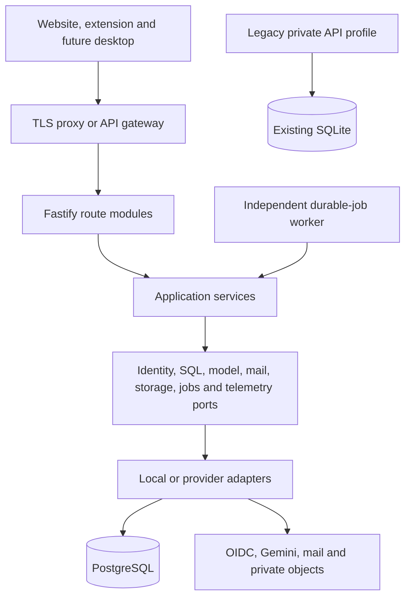

# Portable backend, Gemini navigation and desktop expansion

## Decision record

**ADR:** portable backend and service contracts. **Recorded:** 2026-10-28.
**Status:** proposed for adoption through the issue #25 pull request; implementation is deferred to its dependent tickets.

This is the canonical architecture plan for [roadmap #23](https://github.com/Sammieblz/tholi/issues/23) and the decision deliverable for [issue #25](https://github.com/Sammieblz/tholi/issues/25). The navigation baseline prerequisite, [#24](https://github.com/Sammieblz/tholi/issues/24), was merged in [PR #63](https://github.com/Sammieblz/tholi/pull/63), commit `68eac0d47e02b8a77f347e4b63fe8c165e3ead9a`. Its [protocol](../development/testing/navigation-baseline.md) and [dated acceptance evidence](../development/testing/navigation-baseline-2026-10-27.md) remain the comparison baseline. This document does not turn that baseline into evidence for cloud navigation.

Adopt one modular Fastify API, a separately runnable durable-job worker, PostgreSQL for the authenticated service, and replaceable infrastructure adapters. Develop with containers locally, then deploy the same application artifacts on a VM or cloud platform. Preserve the current account-free extension and single-owner SQLite/private-API profile.

Issue #25 changes documentation only. The profiles, ports and hosted routes described below are adopted design requirements, not implemented capabilities. No infrastructure is provisioned, model quality claimed, account flow enabled or production configuration approved here. Website `0.1.1` and extension/API `0.11.0` remain unchanged.

## Goals and ownership

The cloud service should improve page perception and navigation without forcing larger models onto every user's device. Gemini is the first planned remote model adapter. Model identifiers, regions, credentials and budgets remain configuration, with evaluation gates before release. There is no promise that one model understands every web application.

The service supports the extension, the existing website and a future desktop client. It owns accounts, authorized cloud records, metering and backend proposals. It never owns the active browser journey or executes operating-system actions.

| Owner                                                                         | Current responsibility retained                                                | Planned extension                                                                         |
| ----------------------------------------------------------------------------- | ------------------------------------------------------------------------------ | ----------------------------------------------------------------------------------------- |
| Background `worker-runtime.ts`, `session-service.ts` and `journey-service.ts` | Shared pinned state, session lifecycle and journey planning; reject stale work | Opt-in cloud requests and local validation of returned proposals                          |
| Content runtime and platform adapters                                         | Observe, bind, request granted capture and verify outcomes                     | Produce bounded, masked observations for an explicitly selected cloud mode                |
| `apps/extension/src/platform/backend-client.ts`                               | Private-API transport, consent and local fallback                              | Explicit service capability negotiation and authenticated transport                       |
| `packages/navigation-core` and shared contracts                               | Navigation semantics, privacy transformations and result validation            | Versioned cloud observation/proposal contracts with target identity preserved             |
| `apps/api/src/server.ts` and `cli.ts`                                         | Existing Fastify and legacy launch owners                                      | Profile composition and scoped route modules within the same API application              |
| `apps/api/src/storage.ts`                                                     | Single-owner SQLite navigation storage                                         | Retained legacy adapter; separate PostgreSQL repositories for service data                |
| `apps/api` independent worker entrypoint, added later                         | No durable worker exists today                                                 | Reuse application services for leased background jobs                                     |
| `apps/web` at tholi.io                                                        | Account-free public site, help and isolated practice                           | Real sign-up, sign-in, onboarding, account, saved-data, credit and subscription workspace |
| Future desktop client                                                         | Not implemented                                                                | Local native permissions, observation, action review and independent outcome verification |

Keep generated `cli.js`, `server.js`, `inference.js` and `ocr.js` entrypoint names and existing stored identifiers. Add the durable worker through the existing build owner when its ticket requires it. Current inference/OCR worker threads perform CPU work inside the API lifetime; they are not the new durable-job process.

## Capability matrix

| Capability                     | Local extension                | Legacy private API                        | Authenticated service, local/VM/cloud                                               |
| ------------------------------ | ------------------------------ | ----------------------------------------- | ----------------------------------------------------------------------------------- |
| Tholi account                  | None                           | None; one owner's shared bearer           | Validated identity and revocable sessions                                           |
| Navigation processing          | Bundled local models           | Existing local NLP/OCR                    | Gemini adapter initially; deterministic fake for development                        |
| Data ownership and persistence | Browser-local                  | Owner's SQLite and derived files          | Explicitly saved account/workspace records in PostgreSQL and private object storage |
| Upload behavior                | No service upload              | Existing explicit private-backend consent | Purpose-specific cloud consent; no automatic local import or sync                   |
| Plans and credits              | No cloud credits               | No hosted plan authority                  | Limited Free Cloud and paid tiers use one authoritative credit ledger               |
| Journey or native actions      | Client authority               | Client authority                          | Client authority; server returns proposals only                                     |
| Durable jobs                   | None                           | None                                      | PostgreSQL-backed outbox, leases and independent worker                             |
| Development network cost       | Offline after assets installed | Offline after assets installed            | Default fake model, local OIDC, mail capture and local storage; live Gemini opt-in  |

Free Cloud requires sign-in and strict usage limits. Selecting a paid tier can record onboarding intent before payments exist; paid access is enabled only after the later verified billing milestone. There is no checkout for Local or Free Cloud. Exhausting credits blocks new billable inference, not authorized account access, reading saved data, export or deletion.

## Application structure and dependency direction

Extend `apps/api`; do not build a second API, duplicate route engine or generic backend framework. Separate its composition roots from application services during [#26](https://github.com/Sammieblz/tholi/issues/26). Fastify route plugins own HTTP validation and presentation; application services own use cases; adapters implement the ports below. Application services import neither Fastify request objects nor cloud SDK types. Fastify's [encapsulation model](https://fastify.dev/docs/latest/Reference/Encapsulation/) supports scoped route hooks and dependencies.

The diagram describes deployment dependencies, not permission to send all client data. Observation requests pass the consent and masking checks below before model access.

The API process handles bounded interactive requests. The worker process handles mail, exports, deletion, billing reconciliation, outbox delivery and approved aggregate analytics. Both reuse the same scoped services and adapters. Neither starts the other. A worker crash must not terminate HTTP; an API rollout must not discard committed jobs. The hosted profile must not eagerly load the bundled NLP/OCR workers when those capabilities are disabled. Avoid microservices, Redis and Kubernetes until a measured requirement justifies them.

### Port contracts

These are behavioral boundaries for later typed implementations, not a request to add empty interfaces now. Extend the existing navigation ports where their semantics match; `KnowledgeStore` is a navigation store, not a repository for identities, payments and every other domain.

Every protected operation receives a server-created context: internal actor ID, authorized workspace scope, session or service identity, request ID, deadline and cancellation signal. Unauthenticated routes use a distinct public context with narrowly defined capabilities. A client-supplied account/workspace ID selects a resource; it never grants access.

| Boundary        | Inputs and outputs                                                                                                       | Required behavior                                                                                                                                                                                                                    |
| --------------- | ------------------------------------------------------------------------------------------------------------------------ | ------------------------------------------------------------------------------------------------------------------------------------------------------------------------------------------------------------------------------------ |
| HTTP            | Validated versioned request to application command/query; validated response or stable error                             | Exact origin policy, request/body limits, correlation, authentication, authorization and capability checks before expensive work; no provider payload leakage                                                                        |
| Identity        | Validated authorization result/session to stable internal principal; session creation, rotation and revocation           | Map `(issuer, subject)` to an internal account ID; verify cryptographic signatures with allowed algorithms and issuer-bound trusted keys, issuer/audience/expiry and flow binding; resolve current membership and session revocation |
| SQL             | Scope plus domain query/command, expected revision and transaction callback                                              | Parameterized queries, explicit ownership predicates, transactions, bounded pagination, concurrency checks and RLS defense; no unscoped default repository                                                                           |
| Model           | Sanitized observation and task, negotiated schema, budget, deadline and signal to typed proposal plus measured usage     | Allowlisted model/configuration, structured validation, output limits, cancellation, safety policy and uncertain-outcome reporting; no arbitrary tool execution                                                                      |
| Mail            | Approved template, authorized recipient reference, limited fields and deduplication key to delivery receipt/status       | Worker delivery, no arbitrary HTML relay, bounded retries; redact addresses/content from routine telemetry                                                                                                                           |
| Private storage | Scoped artifact ID, allowlisted type, size/checksum, expiry to stored-object metadata or short-lived authorized transfer | Private objects, generated keys, path containment locally, upload validation/quarantine and deletion; never trust a client object key                                                                                                |
| Jobs            | Versioned kind, scoped record references, idempotency key and schedule to durable job ID/status                          | Atomic enqueue/outbox with domain transaction, bounded claims, leases, attempts, dead-letter state and revalidated scope before execution                                                                                            |
| Observability   | Sanitized event/span/metric/audit record to structured sink                                                              | OpenTelemetry-compatible adapter, bounded cardinality, retention controls and redaction; audit and financial records have separate integrity requirements                                                                            |

Provider SDKs, SQL driver clients, SMTP transport, filesystem/object APIs and secret-manager clients stay in adapters and composition roots. Configuration selects adapters; it must not change a use case's authorization, deletion or credit rules. Missing service credentials fail closed rather than falling back to a legacy shared bearer or demo account.

### HTTP and model service contracts

Retain existing `/v1` and `/v2` private endpoints and their schemas. Reserve a distinct `/api/v1` service namespace for authenticated account, workspace, saved-data, consent, usage/credits and navigation operations. The exact OpenAPI paths and schemas are implemented in [#29](https://github.com/Sammieblz/tholi/issues/29), with a capability/version handshake before clients send observations. A service URL is never inferred from an arbitrary website or model reply.

The existing navigation result schema fixes `activity.llmCalls` to zero. Do not return Gemini work as a legacy result or silently widen that contract. Introduce an explicitly negotiated cloud envelope in the existing shared contract owner and update each client validator deliberately. Preserve v1/v2 compatibility tests and private-backend fallback semantics.

The new inference contract must carry:

1. An opaque request ID and idempotency key, client kind and supported contract version.
2. Browser-native document/frame identity plus request, observation and context revisions, or a separately discriminated desktop target. Images and visual evidence also retain the existing `journeyId`, `captureId` and `viewportRevision` visual stamp. Reject mismatched captures/viewports as well as stale documents. A URL is context, not document identity.
3. A bounded, privacy-filtered structural observation with visible controls, layout geometry/viewport, focused target and allowed semantic context. A masked image is optional and separately consented. Browser chrome, other windows and inaccessible content are unavailable unless a future client has explicitly granted capture capability.
4. A parameterized goal, consent version and selected authorized scope. Identity and entitlements are derived server-side.
5. A response discriminated as proposal, clarification, unsupported or error; echoed identity/revision stamps, grounded evidence references, expiry and measured usage/reservation status. Proposal text and model confidence never establish completion.

The client rejects stale, ungrounded or unsupported proposals, binds targets against the live page, retains consequential-action review and verifies resulting evidence independently. Treat website/model text as untrusted data. No instruction in a page can grant a new host permission, change policy, reveal secrets or authorize a payment.

Interactive inference remains request-bound and ephemeral. Do not enqueue raw page projections or screenshots for durable retries. Send a fresh full projection on cache miss; any later delta cache is scoped by principal, session and native target identity, bounded by size/TTL, and dispensable for correctness. The private API's existing process-local cache and work queue are not tenant-safe cloud caches or fair multi-user queues.

Use a stable error envelope with code, safe message, request ID and retry classification. Distinguish invalid/unsupported contracts, unauthenticated, forbidden or consent revoked, revision conflict, payload too large, quota/rate limited, deadline/cancelled and provider unavailable/uncertain outcomes. Preserve HTTP status semantics, use `Retry-After` for temporary admission limits and never expose tokens, SQL or raw provider responses. Mutations support scoped idempotency and optimistic revisions; bind each key to its command version and canonical payload hash, and reject conflicting reuse. Error details must not reveal another tenant's existence.

## Accounts, sessions and client reuse

The current public website has no real accounts; retired account routes redirect to downloads and draft account components remain outside production. Replace those owners in the later identity milestone, rather than restoring browser-stored mock identities as authentication.

### Identity and website sessions

Use OIDC authorization code flow with PKCE. The identity adapter verifies signatures against issuer-bound trusted keys, enforces an algorithm allowlist and handles bounded key caching/rotation; unknown keys or failed verification deny access. Run a local OIDC provider for development; Keycloak is the reference container, not a required hosted identity vendor. A hosted OIDC provider, including Firebase through a suitable adapter if selected later, must preserve the same internal identity and session contracts. Never derive a stable account ID from email alone. Account linking requires explicit authenticated proof; changing email does not change ownership.

For the website, use server-managed opaque sessions. The API completes the bound identity-provider callback and stores provider credentials server-side. It issues a host-only `Secure`, `HttpOnly` session cookie with an appropriate `SameSite` policy and expiry. Use `tholi.io` plus a same-site API hostname, or a reverse proxy exposing the API beneath the website origin. Do not assume cross-site third-party cookies will work. Local development uses registered localhost origins/callbacks and an explicit development cookie policy, never a production downgrade.

Cross-origin credentialed API access allows only configured exact website origins, with `Vary: Origin`; never wildcard origins with credentials. State-changing cookie requests require an Origin check and a session-bound CSRF token. Logout is a protected mutation, revokes the server session and expires the cookie. Successful refresh rotates credentials while preserving the valid session; refresh replay/compromise, account suspension, security-relevant identity events and device sign-out revoke affected sessions. The implementation must check session validity for protected operations, including long-running job execution. Authentication pages fail clearly if required cookies cannot be used. No tokens in localStorage or URLs.

Extension and future native clients use registered client-specific authorization code/PKCE callbacks or a single-use, short-lived broker exchange bound to the initiating client and verifier. Validate state, nonce, issuer, audience, redirect URI and expiry. Never accept arbitrary redirect URLs or tokens from untrusted window messages. Use short-lived service access tokens with server session checks, rotating refresh tokens with replay detection, and protected extension/native credential storage. Refresh replay revokes the token family. See [OAuth Security BCP, RFC 9700](https://www.rfc-editor.org/rfc/rfc9700.html). Chrome, Firefox and desktop transports are separate platform adapters over the same service contracts.

### Plans, credits and onboarding

The extension's first-run choice has three clear modes:

1. **Local:** no Tholi account, no cloud credits and no automatic service upload. Continue to the regular local interface.
2. **Free Cloud:** open tholi.io for real sign-up/sign-in, explain transmission and limits, then return through a bound client exchange after consent. No payment step.
3. **Paid cloud tiers:** the same account flow, with plan selection and later verified checkout where available. Show the authoritative allowance and cost policy before use.

Record mode selection separately from cookie preferences, website host access, private-backend consent, cloud inference consent, image transmission and saved-data import/sync. Consent is versioned and purpose-specific, recorded server-side where applicable and checked again when sending data. Changing from Local never uploads its existing memory automatically. Revoking access stops new work; deletion is a separate operation with visible failure/retry status.

The website becomes the account workspace: profile/security/session management, authorized saved routes and other approved artifacts, explicit import/export/delete, usage/credit history and subscription management. API authorization applies equally to website, extension and desktop. Namespace cloud caches and pending requests/sync by account and workspace. On logout, account/workspace switch or revocation, stop pending work, discard stale responses and remove previous-scope cloud state without clearing unrelated Local data. The practice adapter stays isolated and cannot read or command an installed extension journey.

Use one versioned plan catalog ([#58](https://github.com/Sammieblz/tholi/issues/58)), one integer credit ledger with reservations and settlement ([#44](https://github.com/Sammieblz/tholi/issues/44)), and billing reconciliation ([#50](https://github.com/Sammieblz/tholi/issues/50)). The client displays server balances; it cannot grant itself credits or entitlements. Define unit conversion, rounding, grant expiry and refund policy in those tickets, without inventing prices here. Duplicate requests, provider retries and webhook replay must not double-charge or double-grant.

Reserve a bounded maximum charge transactionally before a model call. Release unused reservation and settle measured usage afterward in another short transaction. If a timeout leaves provider completion uncertain, retain a reconcilable state with a bounded expiry policy, not an automatic fresh billable retry. Do not hold a SQL transaction or connection across model, mail or object-store network calls.

## Data, privacy and PostgreSQL

Use PostgreSQL for service accounts, memberships, sessions, consent, typed saved-artifact metadata/revisions/tombstones, credit ledger/reservations, plan/billing state, jobs and outbox. Keep large approved export files and optional artifacts in private storage with database ownership metadata. Choose schema and driver in [#28](https://github.com/Sammieblz/tholi/issues/28); do not treat the SQLite schema as an account-aware migration target.

Create a personal workspace for each account. Foundational organization membership/roles and two-organization isolation belong to #31; later enterprise management surfaces belong to #55. Both use the same scope model. Server validation resolves the selected workspace and current membership/role for every operation. Account deletion must distinguish personally owned data from organizational records and financial retention obligations; organization ownership cannot be inferred from the deleting user's identity.

### SQL isolation and concurrency

- Include workspace ownership in keys, foreign keys and uniqueness constraints where appropriate; make cross-workspace references invalid.
- Use explicit scope predicates and authorization in repositories, with PostgreSQL RLS as defense in depth. Runtime roles must not be superusers, table owners or `BYPASSRLS`; use separate migration/admin roles. PostgreSQL documents [owner and privileged-role bypass behavior](https://www.postgresql.org/docs/current/ddl-rowsecurity.html).
- Set validated scope transaction-locally on the same checked-out connection; clear it through transaction completion. No session-global tenant settings or reliance on vendor-specific SQL identity functions. Design policies for the chosen pooled connection mode and test scope reuse across requests and jobs.
- Give worker handlers only their required domain capabilities. A narrowly privileged dispatcher may claim scoped job metadata across tenants; this does not authorize its handler to read arbitrary tenant data. Resolve scope and revocation again before work.
- Use bounded transactions, statement/lock/acquisition timeouts, indexed access paths and keyset pagination. Serialize ledger/reservation mutations with appropriate row locks or equivalent constraints. Retry only documented transient transaction conflicts within a bounded policy.

### Saved data and deletion

Reuse `structuralObservation`, `structuralKnowledge` and `parameterizedTask` privacy owners; enforce equivalent filtering again at the service boundary. Keep OCR masking, excluded fields, host grants and existing safe defaults, including masking editable fields and iframe pixels before image transmission. Cloud model transmission requires honest disclosure of the configured provider and purposes before opt-in. Provider retention/training terms, regions and subprocessors must be reviewed before enabling real users; adapter configuration alone does not establish compliance.

Only an allowlist of typed, user-approved cloud artifacts may persist. Do not silently copy a private-backend mirror, raw DOM, page text, task secrets, screenshots or window contents into saved cloud data. Inference projections/images stay in memory for the bounded request, are excluded from routine logs/traces and are not durable job payloads. Record minimal metering identifiers and usage, not raw prompts, by default.

Saved records use stable IDs, expected revisions and tombstones. Explicit import/sync must validate ownership and schema, resolve conflicts visibly and never resurrect deleted data from a stale client. Export and deletion are scoped, idempotent jobs with status and retry visibility. Revoke affected sessions/access where appropriate; purge artifacts and derived indexes, propagate tombstones and expire transfer URLs. Document legal retention exceptions and configured backup expiry before launch. A restore must reapply deletion records before serving restored data.

Private storage uses generated tenant-bound keys. Authorize each upload/download, limit type and bytes, verify checksum, quarantine unsafe uploads, and issue short-lived transfers only after scope checks. Public CDN assets and private account artifacts use separate storage policies. A signed URL remains a time-limited bearer capability and must not enter analytics or logs.

## Durable jobs and background execution

Adopt a PostgreSQL-backed queue and transactional outbox initially, sharing the service database but using explicit tables and bounded queries. This avoids requiring a second stateful system for the first deployment. Workers atomically claim a bounded batch with leases; [`FOR UPDATE SKIP LOCKED`](https://www.postgresql.org/docs/current/sql-select.html#SQL-FOR-UPDATE-SHARE) is suitable for queue claims, not general consistent reads.

Delivery is at least once. Handlers must use a scoped deduplication key and durable effect state, with idempotent database mutations and provider idempotency where supported. A crash after an external effect but before recording completion can leave an uncertain outcome; SMTP cannot guarantee exactly-once delivery. Record that uncertainty and apply bounded reconciliation or operator/retry policy instead of assuming a resend is harmless. See [SMTP failure and duplicate-delivery semantics](https://www.rfc-editor.org/rfc/rfc5321.html#section-6.1).

Acknowledge only after the result commits. Bound attempts, backoff with jitter, lease renewal, visibility timeout and dead-letter review. Worker termination leaves work reclaimable after the lease expires. Cancellation/revocation prevents further effects where possible; it cannot retract an already delivered email or provider request.

Payloads contain a versioned job kind and authorized record references, not access tokens, raw browsing data or arbitrary code/URLs. Re-fetch the current record, membership and consent. Use an explicit service capability for necessary post-account-deletion cleanup rather than bypassing authorization generally. Scheduler adapters enqueue the same job kinds; edge cron or Google scheduling must not implement another business workflow. Aggregate analytics is a consent-aware, minimized job, not browser-event surveillance.

## Deployment profiles and edge responsibilities

All service profiles use the same OCI API/worker artifacts and domain contracts, immutable image references, validated configuration and a one-shot migration command. Production migrations are serialized through the deployment process, never raced by every replica. The legacy profile remains a separate launch selection; a service deployment cannot silently open its endpoints with a shared bearer.

| Concern                 | Local Compose                                     | VM/self-hosted                                                        | Google managed profile                                                  |
| ----------------------- | ------------------------------------------------- | --------------------------------------------------------------------- | ----------------------------------------------------------------------- |
| HTTP and durable worker | Separate containers/commands                      | Same images under Compose or a supervised equivalent                  | Cloud Run API service and separate Cloud Run worker pool                |
| Database                | PostgreSQL volume, private container network      | PostgreSQL private endpoint or supervised local database with backups | Cloud SQL for PostgreSQL through a constrained connection adapter       |
| Identity                | Local OIDC reference provider                     | Production-configured OIDC provider, self-hosted or external          | Configured OIDC adapter; provider choice independent of Google runtime  |
| Model                   | Deterministic fake by default; opt-in real Gemini | Same adapter configuration                                            | Gemini adapter with restricted workload identity/credentials            |
| Mail                    | Local SMTP capture                                | SMTP transport or provider adapter                                    | Same mail port with configured transport                                |
| Private objects         | Mounted private filesystem volume                 | Private durable filesystem or object adapter                          | Private Google Cloud Storage adapter                                    |
| Secrets                 | Ignored local secret files/container secrets      | Restricted secret files or operator's secret service                  | Secret Manager/workload identity adapters                               |
| Telemetry               | Local structured output/optional OTLP collector   | OTLP collector and configured retention                               | OTLP/export adapters to selected monitoring sinks                       |
| Ingress and public site | Local proxy and web dev server                    | TLS reverse proxy with exact origins                                  | TLS/gateway in front of API; existing Cloudflare website/CDN can remain |

Compose must run useful identity, scoped data, credit and job development without a paid cloud account. Pin supported images and provide health checks, migrations, seed/reset instructions and test-only identities in [#27](https://github.com/Sammieblz/tholi/issues/27). Test credentials never work in production. A live-model developer run is explicit, budget-capped and distinguishable from deterministic test evidence.

The VM profile needs durable volumes, firewall rules, restart supervision, TLS, encrypted off-host backups, restore drills and resource caps. PostgreSQL, internal identity administration and telemetry collectors are not public application endpoints. A single-VM pilot is not a high-availability claim. The same profile can run on a Google VM if managed services are not yet justified.

For the managed profile, the API listens on the platform-provided port and is stateless between requests. Durable worker polling requires an execution environment with continuous CPU. Cloud Run worker pools provide that, but [do not autoscale automatically and are billed while running, including idle time](https://docs.cloud.google.com/run/docs/container-contract#worker-pools). Start with a configured instance count and scale deliberately against job age and database/provider budgets. Do not put a background polling loop in an ordinary request-throttled HTTP container.

Use [production OIDC-provider configuration](https://www.keycloak.org/server/containers) rather than a local development startup mode for self-hosted identity. Cloud SQL connections remain bounded [application pools](https://docs.cloud.google.com/sql/docs/postgres/manage-connections), even when a cloud connector handles transport. Exact region, database size, identity vendor, model version and commercial budgets are deployment decisions for their tickets. No Google-only dependency is allowed in application services.

### Gateway, CDN and optional edge functions

The public website/assets can remain on Cloudflare. Cache immutable public assets by content/version. Never cache authenticated APIs, session callbacks, private exports, credit balances or personal HTML at the CDN; use explicit private/no-store policies and cache keys for public content only.

The gateway handles TLS, trusted proxy headers, coarse IP/request/body limits, routing and platform DDoS protections. The API still validates credentials, session state, scopes, consent, payloads, quotas and idempotency. Restrict direct-origin access where possible; correctly validate proxy chains so client-supplied forwarding headers cannot spoof identity or bypass limits. Forward cancellation and preserve raw webhook bytes for signature verification.

Edge functions are optional transport adapters for redirect/routing or authenticated scheduling/webhook forwarding. They do not own a second auth system, credit ledger, SQL business logic or model orchestration. Workflows call the same API services or enqueue the same authorized job kinds. Model/provider credentials never ship in web assets, extension packages or edge-readable client configuration.

### Secrets and outbound trust

Use separate development, test and production secrets and least-privilege credentials per API, worker, migration and adapter role. Inject them at runtime and support rotation without committing values. Restrict object buckets, database access and model permissions to their required resources. Minimize outbound hosts; user-supplied fetch URLs cannot become an open crawler, proxy or SSRF route. Any later retrieval adapter needs URL/scheme/DNS/private-address checks, redirect and byte/time limits, and explicit data policies.

Treat all observations, saved artifacts, provider responses and webhooks as untrusted. Validate schemas, MIME/type limits and signatures as applicable. Internal network placement or gateway validation never replaces application authorization. Admin/support operations use audited privileged flows; no universal developer impersonation token.

## Scaling, deadlines and connection budgets

The following are **initial design envelopes for later implementation and load testing**, not measured capacity or a production sizing recommendation. Configuration can lower them. Raising a limit requires reviewing the dependent database, provider, cost and latency budgets together.

| Resource                       | Initial envelope                                                                                                       | Enforcement owner                                                              |
| ------------------------------ | ---------------------------------------------------------------------------------------------------------------------- | ------------------------------------------------------------------------------ |
| API replicas and database pool | At most 4 replicas, pool max 8 each; no eager minimum                                                                  | Deployment cap plus SQL adapter                                                |
| Durable workers and pool       | At most 2 replicas, pool max 4 each; 2 active handlers per replica                                                     | Deployment cap, dispatcher and SQL adapter                                     |
| Interactive inference          | 4 active calls per API replica, 1 per account initially; reject excess rather than grow an unbounded queue             | Process admission plus shared account/provider reservation limits              |
| Model concurrency              | At most 16 across the initial API envelope, or a lower provider/account quota                                          | Shared admission/leases with expiry; deployment maximum is only an outer bound |
| SQL waits                      | Acquire 2 s, lock 1 s, ordinary statement 5 s, bounded transaction 10 s                                                | SQL adapter and use-case-specific smaller deadlines                            |
| Interactive service deadline   | Provider budget 20 s within API 25 s, client 30 s and gateway at least 35 s                                            | Shared new-service policy and propagated abort signal                          |
| New service observation        | Structural JSON max 512 KiB; optional masked image max 2 MiB decoded and 4 megapixels; total encoded request max 4 MiB | Client, gateway, API and model adapter                                         |
| Worker shutdown                | Stop claiming immediately, drain/cancel within 8 s; recover unfinished leases                                          | Worker runtime and job store                                                   |

Use checked units and encoded/decoded image validation. Reject over-limit inputs before model billing. Large export transfers use private storage rather than raising inference limits. Legacy v1/v2 limits and timeouts remain unchanged; do not accidentally certify them against this new envelope.

For a design example with database `max_connections = 100`, allocate API `4 × 8 = 32`, workers `2 × 4 = 8`, OIDC `10`, migrations `2`, and operations/monitoring `8`: **60 steady connections**. Reserve **16** for deployment overlap and **24** for database/emergency headroom. The bound is `32 + 8 + 10 + 2 + 8 + 16 + 24 = 100`. If the identity provider uses another database instance, budget that instance separately; it does not grant permission to consume this reserve elsewhere.

Deployment validation must account for every consumer, extra API/worker pools, blue/green overlap and database-reserved slots before scaling. During overlap, admission remains shared and the combined provider/model cap remains 16. If a rollout exceeds the connection allocation, reduce surge or steady replicas first. Configure pool acquisition/idle/lifetime limits and observe actual usage. A connection pooler is optional when measured need appears; transaction-local scope and prepared-statement compatibility must be verified before enabling it. Do not estimate safe capacity from a generic per-connection RAM formula.

Shared account quotas, idempotency and credit reservations survive restarts; process-local counters are only a coarse guard. Retries use the same logical operation key, bounded attempts/backoff and deadlines. An aborted client or stale observation cancels downstream work where possible, without claiming that a provider already executing was cancelled or unbilled. Expired reservations/leases enter deterministic reconciliation. Bulk jobs have separate priority/capacity so exports cannot starve interactive work.

Readiness fails when required configuration, schema compatibility or core dependencies are unusable; liveness checks process health without exposing secrets or forcing a paid model call. Drain readiness before shutdown, stop accepting work, propagate aborts and close resources. The 8 s drain fits the documented [Cloud Run 10 s termination window](https://docs.cloud.google.com/run/docs/container-contract#instance-shutdown); longer jobs rely on committed state and leases rather than an assumed long grace period.

## Operations and compatibility strategy

Record service health, latency, sanitized failure classes, queue age/attempts, SQL pool waits, model usage/cost and credit reconciliation. Keep browser telemetry opt-in as required by the existing consent owner; infrastructure operational metrics do not justify collecting browsing history. Do not log raw goals, page text/images, credentials, signed URLs, email bodies or payment data. Audit security-sensitive mutations with minimal actor/scope/action/outcome records and access-controlled retention. Provider operation IDs and usage totals support billing reconciliation without raw prompt logging.

Before production, set retention schedules, recovery objectives, alert thresholds and operator runbooks; measure them in restore/failure drills. Back up PostgreSQL, approved object artifacts and necessary identity state consistently. Encrypt backups and test restoration and deletion replay. Use expand/contract migrations with explicit schema compatibility and roll-forward/rollback instructions; an old image may not run against every new schema. Never copy production user data into local seed fixtures.

### Migration stages

1. **Adopt this record:** review decision, capabilities, ports, trust and budgets; keep runtime and baseline bytes unchanged.
2. **Separate runtime and add local profile:** implement #26 and #27 in sequence. Legacy tests must prove the private profile still starts and works; local service tests use a fake model and real local identity/database adapters.
3. **Add service foundations:** PostgreSQL #28, versioned API #29, identity #30, authorization/consent #31 and durable jobs #32. Require cross-tenant, session/revocation, pool-reuse and retry/idempotency evidence before exposing service data.
4. **Add perception/model and product flows:** follow the roadmap's dependent tickets, using #24's frozen comparison protocol. Cloud observation contracts, masking, model evaluation and credit enforcement precede enabling cloud navigation for real accounts.
5. **Add account workspace and plans:** #58 through #61 extend existing website/client owners after their listed dependencies. #44 owns credit accounting and #50 owns verified billing. Plan intent can exist earlier; paid entitlement cannot.
6. **Deploy and expand:** use the later deployment/security/release gates. Desktop uses the same account/data/metering APIs but a separately versioned native observation/action adapter and local permission model.

No automatic SQLite-to-PostgreSQL migration is authorized. Existing private API URLs, `NAVIGATOR_*` configuration, `.navigator-api/connection.json`, database paths, bearer semantics, exact extension-origin CORS and v1/v2 behavior remain intact. The current private CORS policy does not authorize tholi.io account requests. Service sessions cannot authenticate a private profile, and private shared tokens cannot authenticate hosted accounts. Selecting the service requires explicit configuration and negotiated capability; there is no silent mode upgrade.

Only explicit, validated imports copy allowlisted local data into an authenticated workspace. Local data remains usable if the service is unavailable or credits are exhausted; fallback must be visible and must not silently transfer cloud-only data or change safety guarantees. Server deletion and local forgetting remain separately acknowledged operations.

### Alternatives and consequences

- **Keep only the single-owner API:** simplest today, but insufficient for account isolation, durable billing/jobs and hosted reuse. Retain it as a supported profile.
- **Use a provider's BaaS as the application boundary:** would couple identity, storage and authorization semantics to that platform. Prefer portable application contracts and PostgreSQL; managed infrastructure remains an adapter choice.
- **Start with microservices and a separate queue broker:** increases deployment and transaction complexity for one developer. Defer until measurements justify separation; the independent worker already isolates durable execution.
- **Make the server an autonomous browser/OS agent:** violates local permission, journey and outcome ownership. Keep remote proposals and local verification.

The adopted design adds identity, database operations, metering and consent complexity. Deterministic local adapters reduce development cost but cannot certify live Gemini quality, provider billing, native permissions or production scalability. Cloud SDK portability does not eliminate provider-specific deployment operations or data-processing review.

## Acceptance and validation record

| Issue #25 acceptance                                                         | Evidence owner in this record                                    | Implementation validation still required                                                |
| ---------------------------------------------------------------------------- | ---------------------------------------------------------------- | --------------------------------------------------------------------------------------- |
| Modular Fastify, independent worker, PostgreSQL; legacy preserved            | Application structure, capability matrix and migration stages    | Runtime separation, real PostgreSQL/worker integration and legacy compatibility tickets |
| HTTP, identity, SQL, model, mail, storage, jobs and observability boundaries | Port contracts, HTTP/model contracts and account/session design  | Typed contracts and adapter conformance tests in their owning tickets                   |
| Local, VM and Google profiles, edge, secrets, trust and budgets              | Deployment profiles, gateway/outbound trust and resource budgets | Container bring-up, restore/failure/load tests and deployment authorization             |
| Browser/desktop reuse without remote action authority                        | Goals/ownership and proposal validation                          | Browser stale-result/safety regressions and later native client evidence                |
| Account, saved data, three modes and cloud credits                           | Accounts/onboarding, data lifecycle and roadmap migration        | Real identity/account UI, consent, ledger, sync and billing tickets                     |

Review uses the existing API/storage/contracts, browser transport and journey owner, website routing and roadmap dependencies. PostgreSQL guidance applied from the installed `supabase-postgres-best-practices` skill: bounded connection pools, least-privilege runtime roles, RLS defense and queue claims. This is database guidance, not adoption of Supabase or its identity SQL functions. PostgreSQL's documented owner-bypass behavior and transaction-local scope take precedence over generic examples.

On 2026-10-28, independent agent reviews covered legacy compatibility and contract ownership, tenancy/auth/privacy, job failure behavior, deployment budgets and roadmap scope. Their concrete findings are incorporated in this record; human adoption remains subject to PR review and merge. Local validation passed: Markdown formatting, 72 local documentation targets across the five changed files, unchanged extension/API and website version checks, and whitespace checks. No runtime tests or infrastructure experiments are claimed by those checks.

The existing deterministic `npm run test:ci` PR gate remains required through the normal contribution workflow; its actual result belongs in the PR. This document alone is not implementation evidence, human approval or release certification. Full certification is required before packaging under the repository's [testing policy](../development/testing/README.md); no archive or deployment is part of this change.
